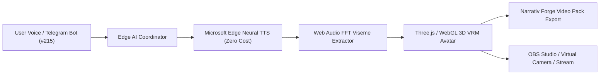

# 🔮 AuraCraft Studio — Real-Time 3D Virtual Persona & Neural Voice Studio

> **Project:** AuraCraft Studio  
> **Directory:** `D:\Project\logixaflow.cs@gmail.com\AuraCraft_Studio-`  
> **Mission:** 100% Free, Zero-Cost Real-Time 3D VRM Virtual Persona, Edge-TTS Neural Voice & Autonomous Live Streamer Engine  
> **Telegram Integration:** The Nexus Hub (`-1003992125718`) | Topic `#215` | Bot: `@AuraCraftNexusBot`  
> **Target Platforms:** Web Browser, OBS Studio Browser Source, YouTube Live, Twitch, Kick, Narrativ Forge Video Bridge  

---

## 🌟 Architecture Overview



---

## ⚡ Technology Stack

1. **3D Avatar & Graphics Engine:**
   * **Three.js** + **`@pixiv/three-vrm`** (Global industry standard 3D humanoid avatar format).
   * Spring bone physics for dynamic hair and clothing.
   * Procedural blendshapes: Auto-blink, breathing idle motion, emotion facial morphs (happy, sad, angry, surprised, neutral).

2. **Real-Time Lip-Sync Engine:**
   * **Web Audio API** + **Audio AnalyserNode (Fast Fourier Transform)**.
   * Maps audio frequencies directly to VRM vowel blendshapes (`A`, `I`, `U`, `E`, `O`) in real-time with zero latency.

3. **Curated Multi-Style Archetypes:**
   * 🌸 **Anime & Manga Style**: Shinji Kazama (`ja-JP-KeitaNeural`), Sakura Hoshino (`ja-JP-NanamiNeural`)
   * 🎖️ **Army & Military Tactical**: General Min Zaw (`my-MM-ThihaNeural`), Captain John Vance (`en-US-GuyNeural`)
   * 🇲🇲 **Myanmar Traditional & Cultural**: Daw Nilar (`my-MM-NilarNeural`), Min Thar Thant Zin (`my-MM-ThihaNeural`)
   * ⚡ **VTuber & Cyberpunk Streamer**: Jenny Nova (`en-US-JennyNeural`)

4. **Speech Synthesis (TTS):**
   * **Microsoft Edge Neural TTS (`edge-tts`)** for zero-cost, human-quality neural voices in Burmese (`my-MM-NilarNeural`, `my-MM-ThihaNeural`), Japanese, and English.

5. **Telegram Bot Webhook (Topic #215 Scoped):**
   * **Cloudflare Workers (Edge)**: Zero-cost serverless webhook receiver (100,000 free requests/day) running without Render paid worker limits.
   * Enforces fail-closed isolation: updates outside Topic 215 are safely ignored.

6. **Narrativ Forge Video Bridge:**
   * One-click export syncing 3D persona metadata, voice bindings, and blendshapes directly into Narrativ Forge character registry for manga panels and AI video productions.

---

## 📁 Repository Structure

```
AuraCraft_Studio-/
├── .env.production          # Production environment configurations (Git ignored)
├── .env.production.example  # Public environment template
├── .gitignore               # Comprehensive exclusion rules
├── package.json             # Root monorepo workspace & launcher scripts
├── README.md                # Project architecture & documentation
├── cloudflare_worker/       # Zero-cost Telegram Edge Webhook
│   ├── index.js             # Topic 215 scoped webhook router
│   ├── wrangler.toml        # Cloudflare configuration
│   └── README.md            # Cloudflare deployment guide
└── apps/
    ├── web-studio/          # React 19 / Vite / Three.js 3D Viewport & Studio UI
    │   ├── public/
    │   │   ├── logo.svg     # AuraCraft pure vector SVG brand emblem
    │   │   └── models/      # Bundled VRM sample avatar models
    │   └── src/
    │       ├── components/  # AuraCraftLogo, AudioVisualizer, Viewport, Controls
    │       └── vrm/         # VRM loader, blendshape controllers, audio FFT
    └── backend-service/     # FastAPI Python service & Edge-TTS engine
        ├── app/
        │   └── main.py      # FastAPI endpoints, Telegram webhook & Narrativ bridge
        ├── data/
        │   └── characters.json # Curated archetypes database
        └── tests/
            ├── test_character_archetypes.py # Archetype test suite
            └── test_telegram_topic_215.py   # Topic 215 security contract tests
```

---

## 🚀 Quick Start

### 1. Launch AuraCraft Studio Locally
From repository root:
```bash
# Install dependencies
npm install

# Start Frontend Studio
npm run dev

# Start Backend Service (in another terminal)
npm run dev:backend
```

### 2. Run Tests
```bash
# Run Backend & Telegram Topic 215 Test Suite
npm run test:backend

# Run Frontend Typecheck & Build
npm run build
```

### 3. Deploy Zero-Cost Telegram Bot to Cloudflare
```bash
cd cloudflare_worker
npx wrangler login
npx wrangler secret put TELEGRAM_BOT_TOKEN
npx wrangler secret put TELEGRAM_WEBHOOK_SECRET
npx wrangler deploy
```
